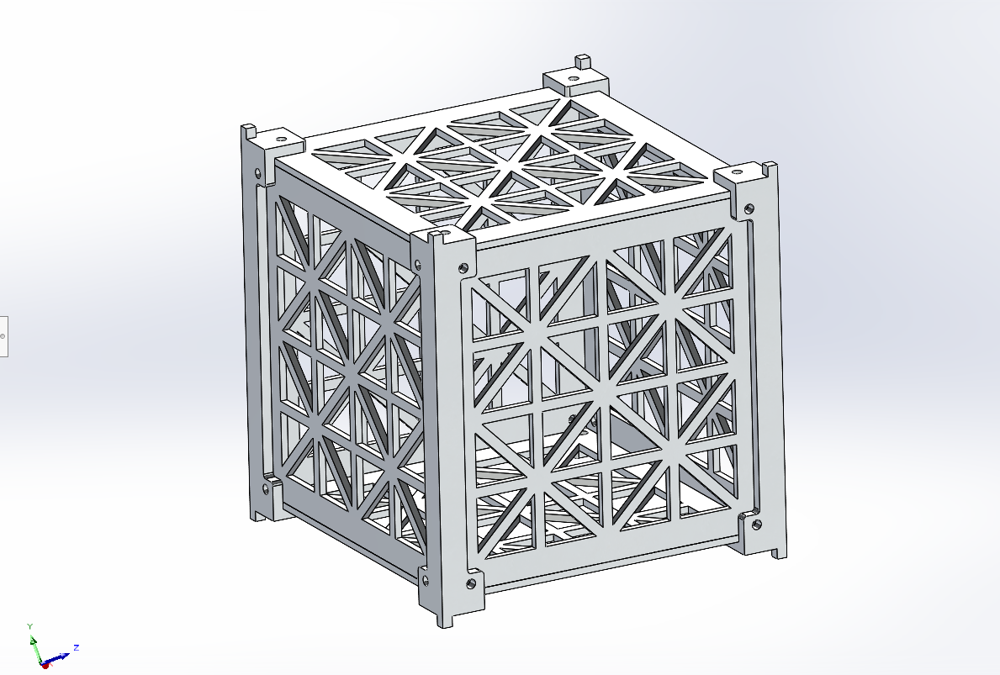
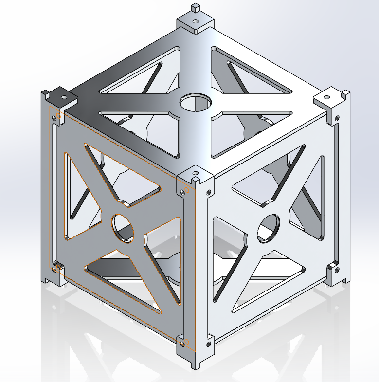
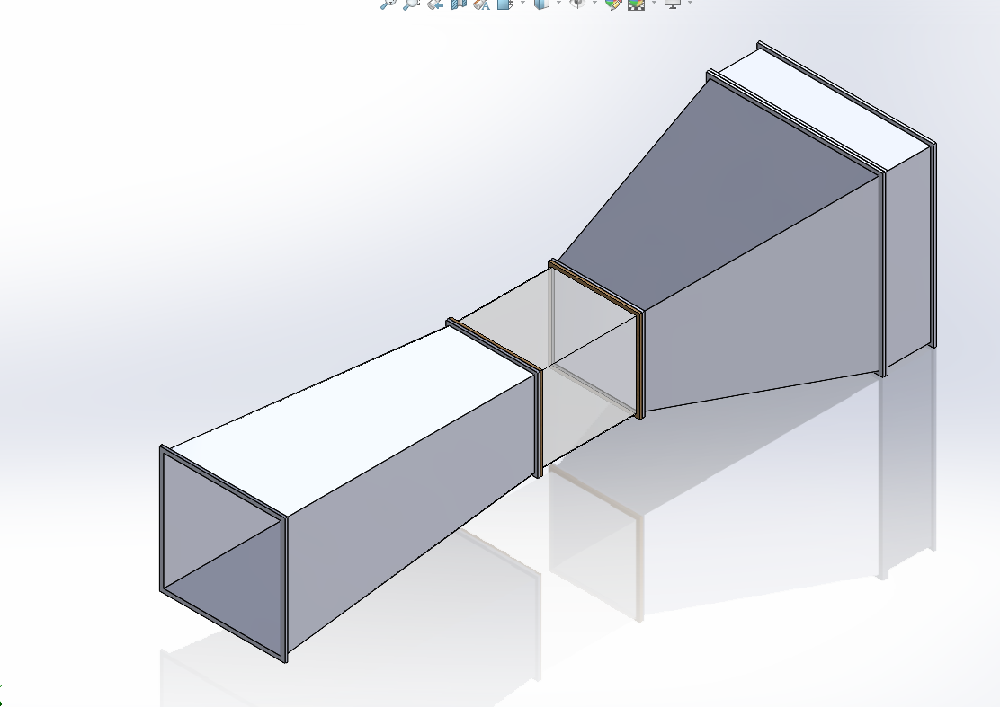

# 1U CubeSat Structure Design

**Imran Ahmed · Junior Research Fellow**  
Bangladesh Space Research and Remote Sensing Organization (SPARRSO) · Dhaka, Bangladesh  
November 2023 – June 2024

I led the SolidWorks design of a 1U CubeSat structure and a windshield, and the subsequent fabrication work using CNC machining and 3D printing. I used Ansys static structural and random vibration simulations to inform the choice of frame geometry and material.

## Project files

| Material | Location |
| --- | --- |
| Frame designs and wind-tunnel rendering | [CAD figures](figures/cad) |
| Static structural contours | [Static analysis figures](figures/static) |
| RMS displacement and stress contours | [Random vibration figures](figures/vibration) |

## Frame designs

| Design 1 · Triangulated lattice panels | Design 2 · X-braced panels with central openings |
| --- | --- |
|  |  |

## Structural analysis

The four plots show the lattice frame. Each value below is the maximum displayed on its plot. The random vibration values are root mean square (RMS) responses.

| Study | Quantity | Displayed maximum | Plot | Video |
| --- | --- | ---: | --- | --- |
| Static structural | Total deformation | 0.70935 mm | [Deformation contour](figures/static/static_structural_test1.jpg) | [Watch deformation](https://www.youtube.com/watch?v=EDYMZ5aezeE) |
| Static structural | Equivalent (von Mises) stress | 91.778 MPa | [Stress contour](figures/static/static_structural_test2.jpg) | [Watch stress](https://www.youtube.com/watch?v=INuOcpVCi8U) |
| Random vibration | RMS resultant displacement | 0.01108 mm | [Displacement contour](figures/vibration/random_vibration_test.jpg) | [Watch displacement](https://www.youtube.com/watch?v=-sUm4AE6DXY) |
| Random vibration | RMS von Mises stress | 5.942 MPa | [Stress contour](figures/vibration/random_vibration_test2.jpg) | [Watch stress](https://www.youtube.com/watch?v=HwircOQOCHw) |

## Interpreting the contours

The static and vibration plots describe different load cases. The RMS stress summarizes the random response, whereas the static stress is the maximum for the applied static load. The exported contours document the lattice design. A comparison with the X-braced design would require the same material properties, constraints, mesh checks and loading for both frames. Reproducing the vibration case also requires the excitation spectrum and damping assumptions.

## Related CAD work

[Browse the project materials on Google Drive](https://drive.google.com/drive/folders/100d4cKkL4a4mFdPlW3-Gb_lSNixu86OF?usp=sharing)
